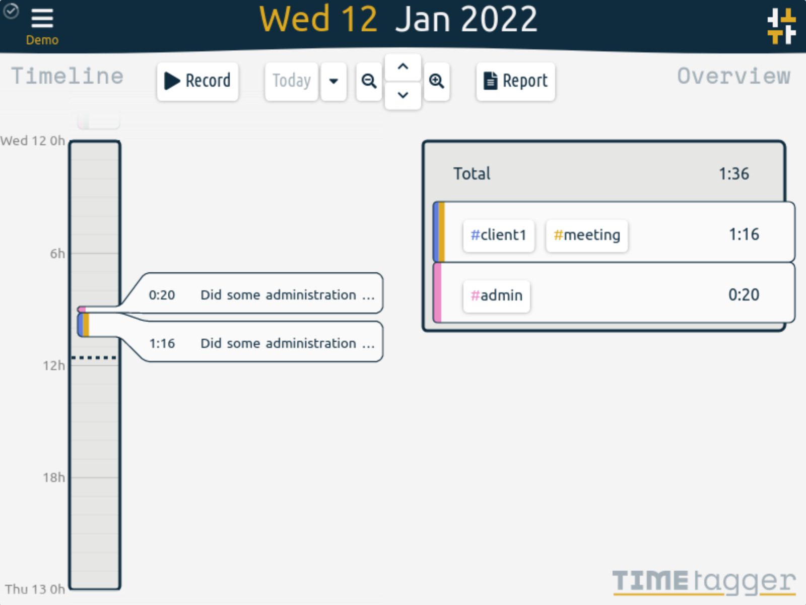

# TimeTagger

TimeTagger is a self-hosted time tracker with an interactive timeline: tag your time as you go, see where the day went at a glance, and export CSV or PDF reports to bill clients. It is a single lightweight Python service with file-based storage — no companion database — built for individuals and freelancers who want their time data on their own server instead of a subscription SaaS.

*TimeTagger's timeline and overview — upstream screenshot from the TimeTagger project site (timetagger.app, `screenshot1.png`), showing the interactive timeline, tag breakdown, and totals. The live UI was verified rendering during end-to-end testing of this template's own deployment.*

## Source Repository

[https://github.com/INAPP-Mobile/timetagger](https://github.com/INAPP-Mobile/timetagger)

## Deploy and Host

One-click deploy creates a single TimeTagger service with a persistent volume. No companion database is needed: TimeTagger stores each user's records in files under the datadir on the volume. On first boot the wrapper maps Railway's injected `PORT` onto TimeTagger's bind address, serves the app at the root path (upstream defaults to `/timetagger/`), and bcrypt-hashes the generated deploy password into the login for user `admin` — so the deploy is usable immediately, with no setup wizard and no email step.

After deploy, open the public URL and sign in as `admin` with the generated `ADMIN_PASSWORD` (find it in your Railway project's variables). Then press Record, tag the entry (e.g. `#client1 #meeting`), and stop it when done — the timeline and overview update immediately. Additional users can be added by setting `TIMETAGGER_CREDENTIALS` directly (see Configuration).

## Why Deploy

- Interactive timeline instead of start/stop forms: drag, split, and edit records right on the day view.
- Tag-based, not project-based: `#client1 #meeting` is faster than maintaining a project tree, and tags combine freely per entry.
- Reports that bill clients: one click exports a detailed CSV or PDF report for any date range.
- Targets and Pomodoro: set daily/weekly/monthly targets per tag and use the built-in Pomodoro timer to stay focused.
- Works offline and syncs: the app is installable as a PWA and syncs records when back online.
- No database service to run: one always-on Python service with file-based storage on a persistent volume.
- Self-hosted data: your time records stay on your Railway volume, with no tracking and no subscription.

## Common Use Cases

- Freelancers tracking billable hours per client and exporting PDF reports for invoices.
- Individuals who want to see, tag by tag, where their week actually went.
- Small teams where each person logs in with their own username (via `TIMETAGGER_CREDENTIALS`) and keeps a separate timeline.
- A private alternative to hosted time trackers, with the data on your own volume.

## Configuration

Only one variable appears on the deploy form, and it is generated:

| Variable | Default | Description |
| --- | --- | --- |
| `ADMIN_PASSWORD` | `${{secret(16)}}` | Password for the `admin` account. Generated on deploy; the wrapper bcrypt-hashes it on every boot and hands it to TimeTagger as the login for user `admin`. Changing it later changes the login password on the next deploy. If `TIMETAGGER_CREDENTIALS` is set directly, it takes precedence and `ADMIN_PASSWORD` is ignored. |

Everything else is baked into the image. Applicable upstream variables and their baked values:

| Variable | Value | Description |
| --- | --- | --- |
| `PORT` | Railway-injected | TimeTagger's HTTP port: the wrapper exports it as `TIMETAGGER_BIND=0.0.0.0:$PORT` on every boot (upstream default is `127.0.0.1:8080`). |
| `TIMETAGGER_BIND` | `0.0.0.0:$PORT` | The address the server listens on, derived from Railway's injected `PORT` (upstream reads config from env vars first). |
| `TIMETAGGER_DATADIR` | `/data` | The single Railway volume: user databases live under `/data/users`. |
| `TIMETAGGER_PATH_PREFIX` | `/` | Serve the app at the root instead of upstream's default `/timetagger/`; the client builds API URLs from the page path, so no frontend patch is needed. |
| `TIMETAGGER_APP_REDIRECT` | `true` | Redirect `/` straight to the app instead of the promotional landing page. |
| `TIMETAGGER_CREDENTIALS` | unset (derived) | Advanced: login credentials as `user:bcrypt-hash,user2:hash2` (generate a hash at https://timetagger.app/cred). When set, it takes precedence over `ADMIN_PASSWORD` — use it for multiple users. |
| `TIMETAGGER_LOG_LEVEL` | `info` | Log level for TimeTagger and its ASGI layer (`debug`, `info`, `warning`, `error`). |
| `TIMETAGGER_PROXY_AUTH_*` | unset | Upstream reverse-proxy auth (`proxy_auth_enabled`, `proxy_auth_trusted`, `proxy_auth_header`); off by default, not needed behind Railway's proxy. |

## Persistence

One volume mounted at `/data` holds the whole TimeTagger datadir (user databases under `/data/users`). Restarts and redeploys keep accounts, records, tags, targets, and settings. Back up the volume to back up TimeTagger.

## Deployment Dependencies

- Plan tier: works on Railway's entry tiers; a single always-on service with a persistent volume.
- RAM needs: light — one Python service, typically well under 256 MB at rest, no companion database or cache service.
- Upstream: [TimeTagger v26.1.3](https://github.com/almarklein/timetagger) (GPL-3.0), image pinned by manifest digest.
