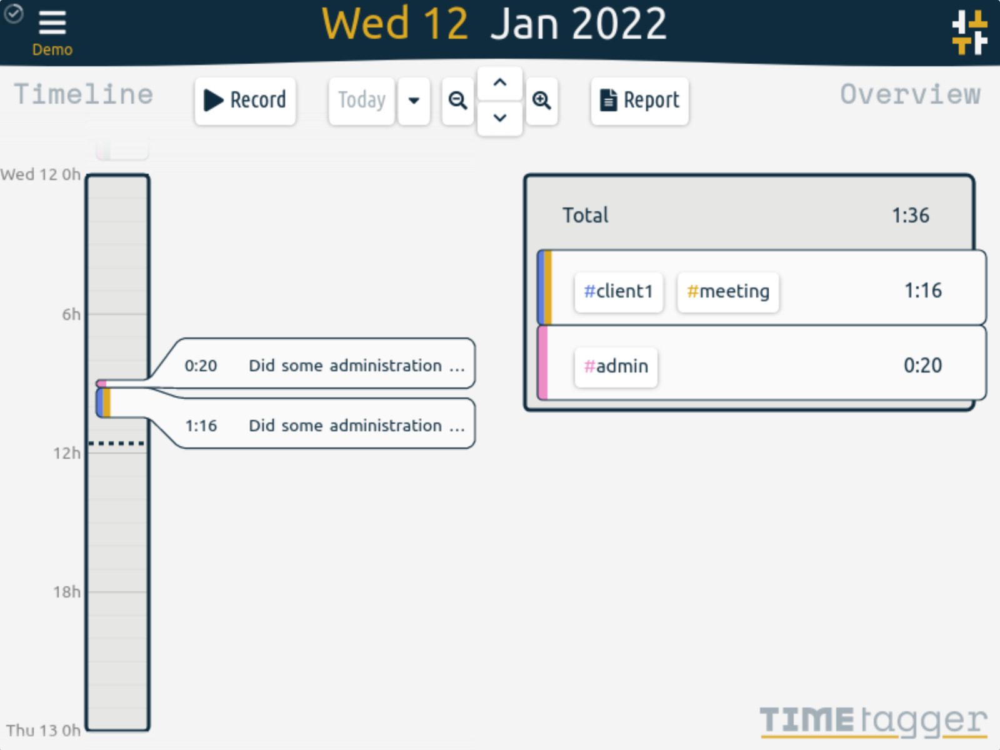

*TimeTagger's timeline and overview — upstream screenshot from the TimeTagger project site (timetagger.app, `screenshot1.png`). The live UI was verified rendering during end-to-end testing of this template's own deployment.*

# Deploy and Host

TimeTagger is a self-hosted time tracker with an interactive timeline: tag your time as you go, see where the day went at a glance, and export CSV or PDF reports to bill clients. One-click deploy creates a single TimeTagger service with a persistent volume and no companion database: each user's records live in files on the volume. After deploy, sign in as `admin` with the generated password from your project's variables, press Record, tag the entry, and the timeline and overview update immediately. There is no setup wizard and no email step.

## About Hosting

Hosting TimeTagger on Railway keeps your time records on your own volume instead of a subscription SaaS. The deployment is a single always-on Python service: the wrapper maps Railway's injected `PORT` onto TimeTagger's bind address on every boot, serves the app at the root path, and bcrypt-hashes the generated deploy password into the `admin` login on every boot. The only deploy-form field is the generated admin password.

## Why Deploy

- Interactive timeline instead of start/stop forms: drag, split, and edit records right on the day view.
- Tag-based, not project-based: `#client1 #meeting` is faster than maintaining a project tree, and tags combine freely per entry.
- Reports that bill clients: one click exports a detailed CSV or PDF report for any date range.
- Targets and Pomodoro: set daily/weekly/monthly targets per tag and use the built-in Pomodoro timer to stay focused.
- Works offline and syncs: the app is installable as a PWA and syncs records when back online.
- No database service to run: one always-on Python service with file-based storage on a persistent volume.
- Self-hosted data: your time records stay on your Railway volume, with no tracking and no subscription.

## Common Use Cases

- Freelancers tracking billable hours per client and exporting PDF reports for invoices.
- Individuals who want to see, tag by tag, where their week actually went.
- Small teams where each person logs in with their own username (via `TIMETAGGER_CREDENTIALS`) and keeps a separate timeline.
- A private alternative to hosted time trackers, with the data on your own volume.

## Dependencies for

- A single TimeTagger service (Python, file-based storage, no companion service).
- One persistent volume mounted at `/data` (user databases under `/data/users`).
- Environment variables (condensed reference — full documentation in the repo README):

| Variable | Default | Description |
| --- | --- | --- |
| `ADMIN_PASSWORD` | generated | Password for the `admin` account; bcrypt-hashed by the wrapper on every boot. |
| `PORT` | Railway-injected | TimeTagger's HTTP port, mapped by the wrapper on every boot (upstream default 127.0.0.1:8080). |
| `TIMETAGGER_CREDENTIALS` | unset | Advanced multi-user login as `user:bcrypt-hash,...`; takes precedence over `ADMIN_PASSWORD` when set. |
| `TIMETAGGER_DATADIR` | `/data` | The Railway volume (user databases under `/data/users`). |
| `TIMETAGGER_PATH_PREFIX` | `/` | Serve the app at the root instead of upstream's default `/timetagger/`. |
| `TIMETAGGER_APP_REDIRECT` | `true` | Redirect `/` straight to the app instead of the landing page. |
| `TIMETAGGER_LOG_LEVEL` | `info` | Log level (`debug`, `info`, `warning`, `error`). |

### Deployment Dependencies

- Plan tier: works on Railway's entry tiers; a single always-on service with a persistent volume.
- RAM needs: light — one Python service, typically well under 256 MB at rest, no companion database or cache service.
